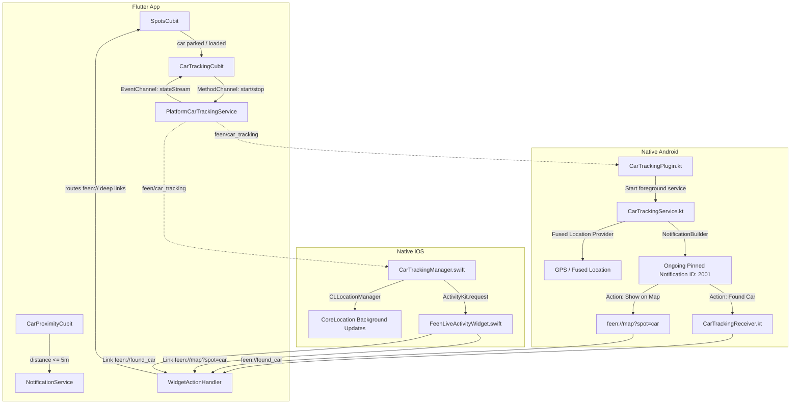
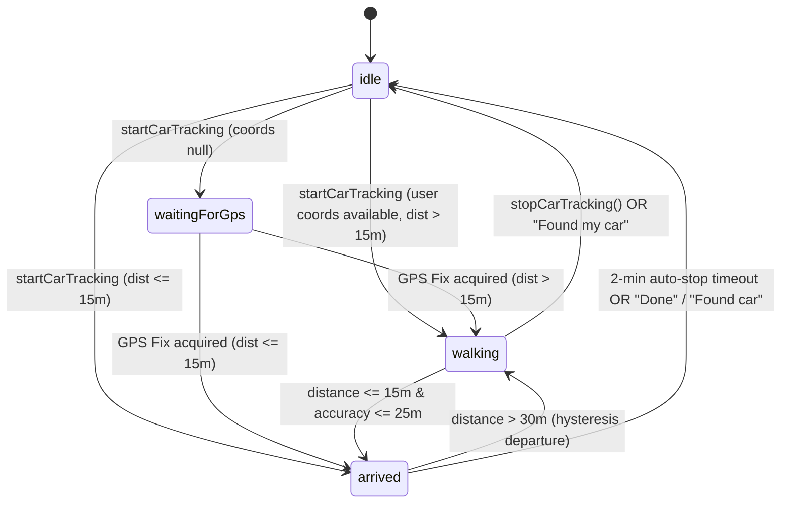
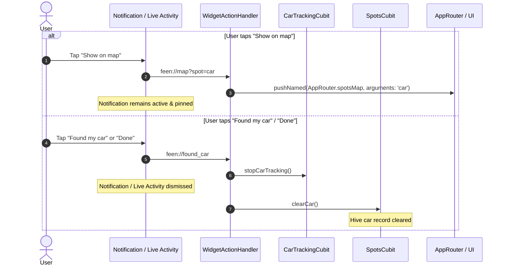

# Feen (فين) — Notification & Live Activity Architecture

This document provides a comprehensive technical reference for the notification and live tracking subsystems in the Feen mobile application across Flutter, native Android, and native iOS.

---

## 1. Architectural Overview

Feen uses a **two-tier notification architecture**:

1. **Local Notification Engine (`NotificationService`)**:
   - Backed by `flutter_local_notifications`.
   - Used for one-shot, high-priority notifications such as the **Car Arrival Alert** (triggered when the user returns within 5 meters of their parked car while the app is in the background or foreground).
   - Manages OS permission dialogs on Android 13+ and iOS.
   - Manages notification action button callbacks.

2. **Real-Time Car Distance Tracking & Live Activity Engine (`CarTrackingService`)**:
   - Backed by custom platform channels (`feen/car_tracking` & `feen/car_tracking/events`).
   - **Android**: An ongoing, pinned Foreground Service (`CarTrackingService.kt`) with `FOREGROUND_SERVICE_LOCATION` and Fused Location updates.
   - **iOS**: An ActivityKit **Live Activity** and Dynamic Island widget (`FeenLiveActivityWidget.swift`) powered by CoreLocation background updates (`CarTrackingManager.swift`).
   - Displays real-time geodesic distance, walking time (at 1.4 m/s), parking elapsed time, and quick actions ("Show on map" and "Found my car" / "Done").



---

## 2. Local Notifications (`NotificationService`)

Located in [`lib/shared/services/notification_service.dart`](file:///Users/salem/Mobile/feen/lib/shared/services/notification_service.dart).

### 2.1 Initialization & Configuration
- **Android Settings**: Uses `@mipmap/ic_launcher` as default notification icon.
- **Darwin (iOS) Settings**:
  - Registers two custom notification categories:
    - `'parking_category'` with actions `actionOnMap` ("On map") and `actionFoundCar` ("Found my car").
    - `'arrival_category'` with actions `actionOnMap` and `actionFoundCar`.
  - Sets `defaultPresentAlert`, `defaultPresentSound`, `defaultPresentBanner`, and `defaultPresentList` to `true`.
- **Response Listener**: Implements static callback caching via `setResponseListener(DidReceiveNotificationResponseCallback? l)`. If a notification tap launched the application cold before the handler was registered in `WidgetActionHandler`, the pending response is buffered and executed as soon as the listener registers.

### 2.2 Permissions
- **Method**: `requestPermission()`
- **Android 13+ (API 33+)**: Invokes `AndroidFlutterLocalNotificationsPlugin.requestNotificationsPermission()`.
- **iOS**: Requests `UNAuthorizationOptions` for `alert`, `badge`, and `sound`.

### 2.3 Notification Channels

| Channel ID | Channel Name | Importance / Priority | Purpose |
|------------|--------------|-----------------------|---------|
| `car_arrival` | Car Arrival Alerts | `Importance.max` / `Priority.high` | Alerts when user returns within 5m of parked car. Displays large car icon, color `#FF6B4A`, and action buttons. |
| `parking_status` | Car Parking Status | `Importance.low` / `Priority.low` | Reserved for legacy local notifications (ID 1001). Canceled upon parking in favor of the active `CarTrackingService`. |

### 2.4 Car Arrival Proximity Notification
- **Trigger**: [CarProximityCubit](file:///Users/salem/Mobile/feen/lib/shared/cubits/car_proximity/car_proximity_cubit.dart) tracks distance to the parked car. When the user walks $\ge 15\text{ m}$ away and later returns to $\le 5\text{ m}$, `showCarArrivalNotification(...)` is triggered.
- **Android Payload**:
  - `styleInformation`: `BigTextStyleInformation` with title, body, and summary text `Feen • Car Arrival`.
  - `actions`:
    - `actionFoundCar`: `✅ Found my car` (dispatches to `feen://found_car`).
    - `actionOnMap`: `🗺️ On map` (dispatches to `feen://map?spot=car`).
  - `category`: `AndroidNotificationCategory.recommendation`.
  - `subText`: `Feen Live`.
  - `color`: `#FFFF6B4A`.
- **iOS Payload**:
  - `interruptionLevel`: `InterruptionLevel.timeSensitive`.
  - `categoryIdentifier`: `'arrival_category'`.
  - `threadIdentifier`: `'feen_parking'`.
  - `payload`: `'feen://car'`.

---

## 3. Real-Time Car Distance Tracking Platform Channels

### 3.1 Channel Specifications

- **Method Channel**: `feen/car_tracking`
- **Event Channel**: `feen/car_tracking/events`

#### Method Channel API (`feen/car_tracking`)

| Method | Arguments | Returns | Description |
|---|---|---|---|
| `start` | `carLat: Double`<br>`carLng: Double`<br>`spotId: String`<br>`carSavedAt: Double` (ms)<br>`carName: String`<br>`isArabic: Boolean`<br>`userLat: Double?`<br>`userLng: Double?` | `Boolean` | Starts tracking session. Seeding with `userLat`/`userLng` allows instantaneous distance calculation on frame 0. |
| `stop` | None | `void` | Stops tracking, terminates foreground service on Android, and dismisses Live Activity on iOS. |
| `isRunning` | None | `Boolean` | Returns whether a tracking session is currently active. |

#### Event Channel API (`feen/car_tracking/events`)

Streams state events from native platforms into Flutter:

```json
{
  "state": "waitingForGps" | "walking" | "arrived" | "stopped" | "foundCar",
  "distanceMeters": 142.5,
  "walkMinutes": 2,
  "progress": 0.45,
  "isArabic": false,
  "isArrived": false
}
```

### 3.2 State Machine (`CarTrackingStatus`)



- **`idle`**: No active tracking session.
- **`waitingForGps`**: Tracking session started but user location is unknown. (Bypassed if coordinates are already known).
- **`walking`**: Active session with live distance and estimated walk time.
- **`arrived`**: User is within 15 meters of the car. Pinned notification/Live Activity displays "Done" and arrival message. Starts a 2-minute auto-dismiss timer.
- **`stopped`**: Tracking terminated.

### 3.3 Geodesic Mathematics (`CarTrackingCalculator`)

Located in [`lib/shared/utils/car_tracking_calculator.dart`](file:///Users/salem/Mobile/feen/lib/shared/utils/car_tracking_calculator.dart):
- **Distance Formula**: Haversine geodesic calculation with Earth radius $R = 6,371,000\text{ m}$.
- **Distance Formatting**:
  - $< 100\text{ m}$: Rounded to nearest $5\text{ m}$ (e.g., `15 m` / `15 م`).
  - $100\text{ to }999\text{ m}$: Rounded to nearest $10\text{ m}$ (e.g., `240 m` / `240 م`).
  - $\ge 1\text{ km}$: Formatted to 1 decimal place (e.g., `1.2 km` / `1.2 كم`).
- **Walking Time Estimation**: Calculated at standard walking speed $v = 1.4\text{ m/s}$:
  - $< 60\text{ seconds}$: `Less than a minute` / `أقل من دقيقة`.
  - $\ge 1\text{ minute}$: `ceil((seconds - epsilon) / 60)`.
  - Formatted with Arabic plurals (`حوالي دقيقة سيرًا`, `حوالي دقيقتين سيرًا`, `حوالي N دقائق سيرًا`, `حوالي N دقيقة سيرًا`).
- **Progress Calculation**: $\text{progress} = \text{clamp}(1.0 - (\text{distance} / \text{startDistance}), 0.0, 1.0)$.
- **1.5x Auto-Reset**: If the user moves away such that $\text{distance} > 1.5 \times \text{startDistance}$, `startDistance` resets to the new distance to keep progress realistic.
- **Arrival Hysteresis**:
  - Enters `arrived` when $\text{distance} \le 15\text{ m}$ and $\text{accuracy} \le 25\text{ m}$.
  - Exits `arrived` back to `walking` only when $\text{distance} > 30\text{ m}$.
- **Max Tracking Boundary**: If distance exceeds $50\text{ km}$, live walking tracking is disallowed.

---

## 4. Android Native Implementation

### 4.1 Foreground Service (`CarTrackingService.kt`)
- **Service Class**: [`android/app/src/main/kotlin/com/example/feen/CarTrackingService.kt`](file:///Users/salem/Mobile/feen/android/app/src/main/kotlin/com/example/feen/CarTrackingService.kt)
- **Service Type**: `foregroundServiceType="location"`.
- **Immediate Seed Location**: When `startService` receives `EXTRA_USER_LAT` and `EXTRA_USER_LNG`, it constructs a synthetic seed `Location("seed")` and processes `handleLocationFix(seedLocation)` on frame 0.
- **Cached Location Query**: Immediately calls `fusedLocationClient.lastLocation.addOnSuccessListener` to obtain the most recent cached GPS fix without waiting for hardware satellites.
- **Location Request Configuration**:
  - `Priority`: `Priority.PRIORITY_HIGH_ACCURACY`.
  - `minUpdateDistanceMeters`: `0f` (allows updates while stationary or moving slowly).
  - `minUpdateIntervalMillis`: `2_000L`.
  - `interval`: `4_000L` (normal) or `10_000L` (when `PowerManager.isPowerSaveMode` is active).

### 4.2 Notification Construction (`CarTrackingNotificationBuilder.kt`)
- **Channel**:
  - `ID`: `car_tracking`
  - `Name`: Feen Car Tracking
  - `Importance`: `NotificationManager.IMPORTANCE_LOW` (silent, persistent).
- **Custom RemoteViews Layouts (iOS Live Activity Equivalent)**:
  - **Collapsed View** (`R.layout.notification_car_tracking_collapsed`):
    - Dark indigo card background (`#14143A`, 16dp rounded corners).
    - Top row: App icon in indigo circle badge, app name ("Feen" / "فين"), relative parking time badge.
    - Content row: 28sp bold distance digits, walking time detail, and compact "Show on map" pill button.
  - **Expanded View** (`R.layout.notification_car_tracking_expanded`):
    - Full hero view matching the iOS Lock Screen card.
    - Large 34sp heavy rounded distance digits.
    - Walking time detail (turns emerald `#0E9F75` when within 15 meters).
    - Two large pill buttons:
      - **"Show on map"**: High-contrast white capsule with map vector icon (`#1B1B3A` text).
      - **"Found my car" / "Done"**: Translucent capsule with white border (`#FFFFFF` text).
- **Notification Attributes**:
  - `setOngoing(true)` & `setAutoCancel(false)`: Prevents swipe-to-dismiss while walking.
  - `setCategory(NotificationCompat.CATEGORY_NAVIGATION)`.
  - `setVisibility(NotificationCompat.VISIBILITY_PUBLIC)`.
  - `setCustomContentView(collapsedViews)`.
  - `setCustomBigContentView(expandedViews)`.
  - `setStyle(NotificationCompat.DecoratedCustomViewStyle())`.
- **Button PendingIntents via `HomeWidgetLaunchIntent`**:
  1. **Show on map**:
     - `HomeWidgetLaunchIntent.getActivity(context, MainActivity::class.java, Uri.parse("feen://map?spot=car"))`.
     - Delivers action `"es.antonborri.home_widget.action.LAUNCH"` recognized by `home_widget` plugin, triggering `WidgetActionHandler` to navigate directly to `AppRouter.spotsMap` without dismissing the notification.
  2. **Found my car / Done**:
     - `HomeWidgetLaunchIntent.getActivity(context, MainActivity::class.java, Uri.parse("feen://found_car"))`.
     - `MainActivity` immediately terminates `CarTrackingService` (dismissing the notification in 0ms), and delivers `feen://found_car` to `WidgetActionHandler` which clears the car in Hive.

### 4.3 Broadcast Receiver (`CarTrackingReceiver.kt`)
- Handles `com.example.feen.ACTION_FOUND_CAR`.
- Calls `CarTrackingService.stopService(context)`.
- Dispatches event `{"state": "foundCar"}` through `CarTrackingPlugin`.
- Starts `MainActivity` with `feen://found_car` to clear the car in Hive.

### 4.4 Android Manifest Configurations
In [`android/app/src/main/AndroidManifest.xml`](file:///Users/salem/Mobile/feen/android/app/src/main/AndroidManifest.xml):
```xml
<uses-permission android:name="android.permission.INTERNET" />
<uses-permission android:name="android.permission.ACCESS_FINE_LOCATION" />
<uses-permission android:name="android.permission.ACCESS_COARSE_LOCATION" />
<uses-permission android:name="android.permission.POST_NOTIFICATIONS" />
<uses-permission android:name="android.permission.FOREGROUND_SERVICE" />
<uses-permission android:name="android.permission.FOREGROUND_SERVICE_LOCATION" />

<service
    android:name=".CarTrackingService"
    android:foregroundServiceType="location"
    android:exported="false" />

<receiver
    android:name=".CarTrackingReceiver"
    android:exported="false" />

<activity
    android:name=".MainActivity"
    android:launchMode="singleTop">
    <intent-filter>
        <action android:name="android.intent.action.VIEW" />
        <category android:name="android.intent.category.DEFAULT" />
        <category android:name="android.intent.category.BROWSABLE" />
        <data android:scheme="feen" />
    </intent-filter>
</activity>
```

---

## 5. iOS Native Implementation (ActivityKit & CoreLocation)

### 5.1 Manager (`CarTrackingManager.swift`)
- **File**: [`ios/Runner/CarTrackingManager.swift`](file:///Users/salem/Mobile/feen/ios/Runner/CarTrackingManager.swift)
- **Background Location**:
  - `CLLocationManager` configured with `desiredAccuracy = kCLLocationAccuracyNearestTenMeters`.
  - `allowsBackgroundLocationUpdates = true`.
  - `showsBackgroundLocationIndicator = true` (shows the blue location indicator pill in the iOS status bar).
  - `pausesLocationUpdatesAutomatically = false`.
- **Immediate Seed Location**:
  - Accepts `userLat` and `userLng` in method call `start`.
  - Calculates initial distance and begins the Live Activity on frame 0 using `seedLocation`.

### 5.2 Attributes & ContentState (`FeenTrackingAttributes.swift`)
```swift
public struct FeenTrackingAttributes: ActivityAttributes {
  public struct ContentState: Codable, Hashable {
    public var state: String            // "waitingForGps", "walking", "arrived"
    public var distanceText: String     // e.g. "120 m" / "120 م"
    public var detailText: String       // e.g. "About 2 min walk" / "أنت على بعد أقل من 15 م"
    public var parkedText: String       // e.g. "Parked 2 h ago" / "رُكنت منذ 2 س"
    public var progress: Double         // 0.0 to 1.0
    public var isArrived: Bool
    public var onMapLabel: String       // "Show on map" / "اعرض على الخريطة"
    public var foundLabel: String       // "Found my car" / "وجدتُ سيارتي" / "Done"
    public var appName: String          // "Feen" / "فين"
  }
  public var carName: String
}
```

### 5.3 Live Activity Widget (`FeenLiveActivityWidget.swift`)
- **File**: [`ios/FeenLiveActivity/FeenLiveActivityWidget.swift`](file:///Users/salem/Mobile/feen/ios/FeenLiveActivity/FeenLiveActivityWidget.swift)

#### Lock Screen Presentation
- Uses `ActivityConfiguration(for: FeenTrackingAttributes.self)`.
- **Background**: Deep Indigo/Night tint (`#14143A`) with `activityBackgroundTint`.
- **Header**: Feen pin icon, app name, and relative parked time.
- **Body**: Heavy rounded typography for distance (34pt) and detail status.
- **Deep Links**:
  - Entire card has `.widgetURL(URL(string: "feen://map?spot=car"))`.
  - **"Show on map" button**: `Link(destination: URL(string: "feen://map?spot=car")!)` (White pill with map icon).
  - **"Found my car" / "Done" button**: `Link(destination: URL(string: "feen://found_car")!)` (Translucent glass pill).

#### Dynamic Island Presentations
- **Expanded**:
  - Leading: Pin icon and App Name (`Feen` / `فين`).
  - Trailing: Walk time or arrival status.
  - Bottom: Large distance text and compact action buttons (`Show on map` & `Found my car`).
- **Compact Leading**: Map pin icon (Coral `#FF8A65` while walking, Green `#0E9F75` when arrived).
- **Compact Trailing**: Live distance text.
- **Minimal**: Map pin icon.

---

## 6. Deep Linking & Action Routing

The deep link routing is centralized in [`lib/app/widget_action_handler.dart`](file:///Users/salem/Mobile/feen/lib/app/widget_action_handler.dart).



### Deep Link Registry

| URI | Origin | Resulting Action |
|---|---|---|
| `feen://map?spot=car` | Android action "Show on map"<br>iOS Live Activity "Show on map"<br>Tap on notification body | Opens app, navigates to `AppRouter.spotsMap` centering on the car spot. **Does not dismiss** notification. |
| `feen://found_car` | Android action "Found my car" / "Done"<br>iOS Live Activity "Found my car" / "Done" | Dismisses notification/Live Activity, cancels tracking service, and clears the car in Hive. |
| `feen://park` | Native Home Widget tap ("Park") | Overwrites car spot with current GPS position and begins tracking session. |
| `feen://car` | Native Home Widget tap ("Find car")<br>Car Arrival local notification tap | Opens in-app map centered on the car. |

---

## 7. In-App Tracking Banner (`car_card.dart`)

Located in [`lib/modules/home/widgets/car_card.dart`](file:///Users/salem/Mobile/feen/lib/modules/home/widgets/car_card.dart) as `_TrackingStatusBanner`:
- **Render Trigger**: Displayed on the car card whenever `trackingState.isRunning` is `true`.
- **Styling**: Rounded container with soft primary/arrival tint (`AppDimens.borderRadiusMedium`, 12dp padding).
- **Status Indicator**:
  - Walking: `Icons.directions_walk_rounded` in Primary color with distance and estimated walk time.
  - Arrived: `Icons.check_circle_rounded` in Emerald Green (`#0E9F75`) with arrival body text.
- **Action Button**:
  - Walking: TextButton `Stop` (`l10n.carTrackingStop`) calling `context.read<CarTrackingCubit>().stopCarTracking()`.
  - Arrived: TextButton `Done` (`l10n.carTrackingDone`) calling `onDone` (`_handleFoundCar`) to clear the car and dismiss tracking.
- **No Progress Bar**: Displays status text directly without indeterminate loading spinners.

---

## 8. Verification & Test Suite

All notification, calculation, state management, and platform bridging components are covered by unit tests:

1. **`test/car_tracking_test.dart`**:
   - `CarTrackingCalculator`: Distance accuracy, rounding rules, Arabic localization, walking time calculations, progress clamping, 1.5x reset, hysteresis arrival boundary (15m in / 30m out), and 50km max distance check.
   - `CarTrackingState`: Immutability, `copyWith`, and equality.
   - `CarTrackingCubit`: Rejecting distances $> 50\text{ km}$, instant calculation with user coordinates, fallback to `waitingForGps` when coordinates are null, 2-minute arrival auto-stop timer.
2. **`test/widget_test.dart`**:
   - `CarProximityCubit`: Parking distance thresholds, triggering arrival notification at $\le 5\text{ m}$ only after having moved $\ge 15\text{ m}$ away, and proximity state cleanup upon clearing car.
